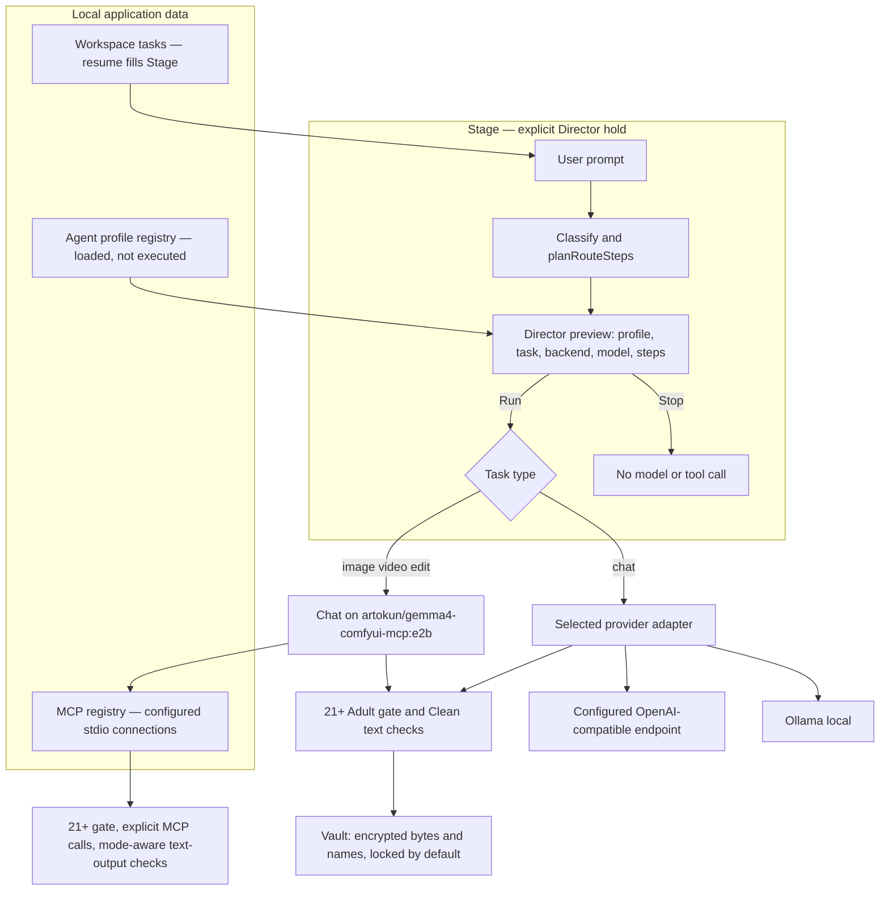

# Trolly Agent architecture

The provider dropdown is available at startup. Ollama uses its local API; OmniRoute,
OpenCode-through-OmniRoute, Hermes, and custom providers use an OpenAI-compatible
`/models` and `/chat/completions` endpoint. Provider credentials remain in that
service. Image attachments are currently supported only by Ollama.

Agent profiles are loaded from `agent-profiles.json` and can be selected in Stage.
No profile runs at startup. Task titles, notes, and statuses are stored locally in
`tasks.json`; resuming a task only populates the Stage composer.

Fresh MCP configuration is empty. The UI offers filesystem, custom agent, browser,
Playwright, and ComfyUI MCP (`npx --yes comfyui-mcp`) stdio templates. Image, video,
and edit jobs stay in Stage chat and select only `artokun/gemma4-comfyui-mcp:e2b`.
The Comfy template does not connect by itself. After Connect and Director Run, chat on that model may make one Ollama tool round against the connected server. Tool text is filtered after the call. Non-text results are withheld. New servers are not auto-connected; previously
enabled config entries may reconnect at startup only after 21+ verification.
Connecting and calling tools require the same verification and explicit user
action. The filesystem template passes an explicit folder to its server; Trolly
does not sandbox arbitrary stdio commands. HTTP MCP transports are not implemented.

Mind checks a full, self-reported date of birth against 21+ in memory and stores
only the verification state and policy threshold; this is not identity
verification, and legacy year-only checks are invalidated.
Clearing verification locks the Vault, disconnects MCP servers, and switches the
session to Clean. Clean applies limited lexical checks to chat and text/tool
output. Standard image/video prompts reject adult, under-21, and gore terms, but
These text checks do not certify generated media or an MCP server's side effects.
Chat image attachments are blocked until a suitable local age/content classifier
exists. Local dictation accepts only a bounded WebM transcription request; the
result still passes the active text-content policy.
MCP text output is screened in both modes: Adult sexual text needs explicit 21+
ages, restricted harm/gore terms are blocked, and non-text output is withheld.
This happens after a tool call, so it cannot undo server side effects.

The Vault encrypts file bytes and the filename index with AES-256-GCM. A random
Vault key is wrapped by a scrypt-derived password key; new passwords require at
least 12 characters. Legacy plaintext media is migrated only after explicit
confirmation. Locking clears the in-memory key. After Dark requires explicit
numeric 21+ ages and validates the prompt before reference upload; its local
vision check fails closed. Output defaults under app data or honors the explicit
`TROLLY_AFTER_DARK_DIR` override; source-tree output is rejected.

App data defaults to `path.join(app.getPath('userData'), 'data')`. The
`TROLLY_DATA_DIR` override relocates that root; Vault and Studio can be
overridden separately with `TROLLY_VAULT_DIR` and `TROLLY_STUDIO_DIR`, and
their stores reject paths inside the application source tree. Generated
Artistry media and After Dark output use the same data root by default. A local Studio sample model can be
provided through `TROLLY_STUDIO_SAMPLE_MODEL`.

