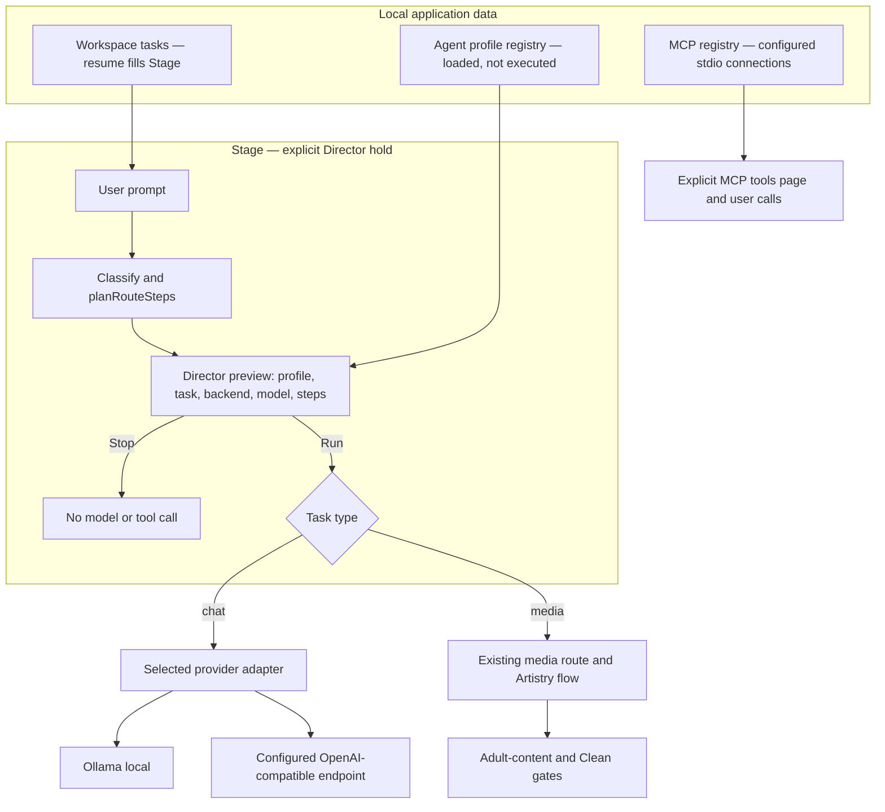

# Trolly Agent architecture

The provider dropdown is available at startup. Ollama uses its local API; OmniRoute,
OpenCode-through-OmniRoute, Hermes, and custom providers use an OpenAI-compatible
`/models` and `/chat/completions` endpoint. Provider credentials remain in that
service. Image attachments are currently supported only by Ollama.

Agent profiles are loaded from `agent-profiles.json` and can be selected in Stage.
No profile runs at startup. Task titles, notes, and statuses are stored locally in
`tasks.json`; resuming a task only populates the Stage composer.

Fresh MCP configuration is empty. The UI offers filesystem, custom agent, browser,
and Playwright stdio templates. New servers are not auto-connected; previously
enabled config entries may reconnect at startup. Filesystem access requires an
explicit root folder. HTTP MCP transports are not implemented.

App data defaults to `path.join(app.getPath('userData'), 'data')`. The
`TROLLY_DATA_DIR` override relocates that root; Vault and Studio can be
overridden separately with `TROLLY_VAULT_DIR` and `TROLLY_STUDIO_DIR`, and
their stores reject paths inside the application source tree. Generated
Artistry media uses the same data root. A local Studio sample model can be
provided through `TROLLY_STUDIO_SAMPLE_MODEL`.

